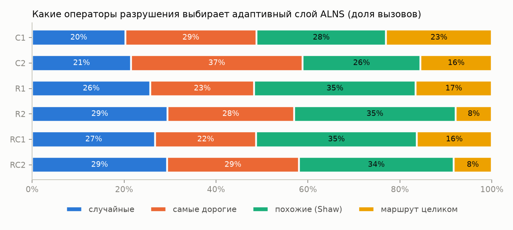
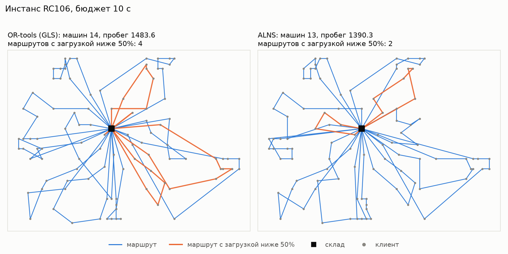

# vrptw-lab — маршруты курьеров с окнами доставки

Машины ограниченной вместимости развозят заказы со склада, у каждого клиента своё окно
доставки. Нужно обслужить всех вовремя минимальным числом машин и с минимальным пробегом.
Это задача VRPTW — та же постановка, что в курьерской доставке: на входе заказы и тайм-слоты,
на выходе маршруты.

Проект сравнивает три решателя на стандартном бенчмарке при одинаковом бюджете времени:

- **жадный** — ближайший сосед с учётом окон (Solomon, 1987), точка отсчёта;
- **OR-tools** — Routing Solver от Google с guided local search, промышленный бейзлайн;
- **ALNS** — своя адаптивная эвристика большой окрестности на Python. Механизм выбора
  операторов перенесён из моей исследовательской работы о гиперэвристиках роевых алгоритмов.

## Результаты

Бюджет 10 секунд на инстанс, у стохастических методов медиана по 3 seed. Все 616 решений
допустимы. Полная сводка с абляциями — [results/summary.md](results/summary.md).

**ALNS обходит OR-tools: лучше на 41 инстансе из 56, ничья на 11, хуже на 4**
(тест Вилкоксона, p = 1,1·10⁻⁷). Выигрыш в основном в числе машин на узких окнах (R1, RC1).

Среднее число машин / среднее расстояние по классам:

| Класс | Лучшее известное | Жадный | OR-tools | ALNS | ALNS, q равномерно |
|---|---|---|---|---|---|
| C1 | 10.00 / 828.4 | 10.44 / 1409.6 | 10.00 / 846.5 | 10.00 / 828.4 | 10.00 / 828.4 |
| C2 | 3.00 / 589.9 | 3.38 / 1085.8 | 3.00 / 593.5 | 3.00 / 601.0 | 3.00 / 599.8 |
| R1 | 11.92 / 1210.3 | 14.67 / 1624.5 | 13.08 / 1231.3 | 12.58 / 1200.3 | 12.58 / 1196.0 |
| R2 | 2.73 / 951.0 | 3.64 / 1705.2 | 3.09 / 968.7 | 3.09 / 949.7 | 3.09 / 941.5 |
| RC1 | 11.50 / 1384.2 | 14.25 / 1822.3 | 13.50 / 1423.9 | 12.38 / 1371.7 | 12.12 / 1365.8 |
| RC2 | 3.25 / 1119.2 | 4.00 / 2091.7 | 3.62 / 1168.2 | 3.38 / 1147.4 | 3.38 / 1130.2 |
| Всего машин / расстояние | 405 / 57187 | 483 / 90936 | 442 / 58535 | 425 / 57267 | 423 / 56930 |

- ALNS берёт столько же машин, сколько лучшее известное решение, на 36 инстансах из 56
  (OR-tools — на 30). Лучшее известное решение — те же машины и не длиннее — ALNS
  повторяет на 16 инстансах, OR-tools на 10. Меньшее среднее расстояние, чем у лучших
  известных, на R1 и R2 — цена лишних машин: короче маршруты, но их больше.
- На C2 (кластеры, длинный горизонт) OR-tools в среднем короче.

### Что не сработало: идеи из исследования

Абляции проверяли, нужны ли две идеи, перенесённые из гиперэвристик:

- **Размер разрушения по Леви хуже равномерного:** равномерный лучше на 19 инстансах, Леви
  на 3, ничья на 34 (p = 0,00014). При равномерном выборе ALNS успевает втрое меньше
  итераций (6 тыс. против 19 тыс.), но крупные разрушения полезнее частых мелких.
  Леви в моей настройке слишком часто правит 4–6 клиентов.
- **Адаптивный выбор операторов не лучше случайного:** 7 лучше, 13 хуже, 36 ничьих
  (p = 0,62). Доля вызовов почти не следует за наградой: «самые дорогие» в среднем
  приносят больше всех, а вызываются не чаще остальных. Награды редкие (в среднем 0,044 из 1 за
  вызов), и оценка успеха по скользящему среднему тонет в шуме.



Следующие эксперименты: Леви со сдвигом к крупным разрушениям (больше `q_min` и
`levy_scale`) и награда, нормированная на время вызова оператора.

### Разбор маршрутов

На RC106 у OR-tools 14 машин, и одна из них загружена на 8 %. У ALNS 13 машин, самая
пустая загружена на 28 %, а суммарное ожидание у клиентов на 29 % меньше. Маршруты с
загрузкой ниже 50 % выделены оранжевым.



## Данные

[Бенчмарк Solomon](https://www.sintef.no/projectweb/top/vrptw/solomon-benchmark/):
56 инстансов по 100 клиентов в шести классах. C — клиенты кластерами, R — разбросаны
случайно, RC — смешанно. В классах 1 короткий горизонт и много машин, в классах 2 длинный
горизонт и мало машин. Лучшие известные решения взяты из
[таблицы SINTEF](https://www.sintef.no/projectweb/top/vrptw/100-customers/). Расстояния
евклидовы без округления, время в пути равно расстоянию.

Цель у всех решателей одна: `1000 × машины + расстояние`. Машина дороже любого выигрыша
в километраже, поэтому это почти тот же порядок «сначала машины, потом расстояние», что
в лучших известных решениях. Это и есть утилизация рейсов: меньше полупустых машин.

## Как устроен ALNS

На каждой итерации ALNS разрушает часть текущего решения и чинит его, а новое решение
принимает по правилу имитации отжига ([Ropke & Pisinger, 2006](https://doi.org/10.1287/trsc.1050.0135)).

- **Разрушение (4 оператора):** случайные клиенты; самые «дорогие» клиенты, без которых
  маршрут сильнее всего сокращается; похожие клиенты (Shaw: близко по месту, времени
  и спросу); маршрут целиком — так ALNS пробует обойтись меньшим числом машин.
- **Починка (2 оператора):** самая дешёвая вставка и regret-2 — первым вставляется клиент,
  которого дороже всего «упустить» из лучшего маршрута.
- **Выбор операторов — probability matching**, как в моей гиперэвристике HyperTree:
  вероятность оператора растёт с долей его успешных вызовов, но не падает ниже 5 %.
- **Размер разрушения — из распределения Леви**, как длина шага в Cuckoo Search: в половине
  итераций удаляется не больше 6 клиентов, в 90 % — не больше 13, изредка до 40, чтобы
  выбраться из локального минимума. В среднем 8 клиентов против 22 у равномерного выбора
  от 4 до 40.
- **Проверка вставки за O(1):** для каждого маршрута хранятся время начала обслуживания и
  самое позднее допустимое начало в каждой точке. Так допустимость вставки проверяется без
  пересчёта маршрута, и итерация занимает доли миллисекунды даже на Python.

Каждое решение каждого метода независимо проверяет `vrptw.solution.evaluate`: все клиенты
обслужены ровно один раз, вместимость и окна соблюдены, машин не больше 25. Эта проверка
нашла настоящий баг: оператор «самые дорогие» удалял клиентов, не пересчитывая кэш
расписания, и ALNS выдавал решения с опозданиями.

## Запуск

```bash
uv sync
uv run pytest
uv run python scripts/run_benchmark.py --time 10 --seeds 3 --jobs 4
uv run python scripts/report.py
```

`run_benchmark.py` дописывает строки в `results/runs.csv` и пропускает уже посчитанные
запуски, так что прогон можно прервать и продолжить. Число процессов не больше числа
производительных ядер: на эффективном ядре запуск успел бы меньше за то же время.

## Структура

```
src/vrptw/instance.py        загрузка инстансов Solomon и лучших известных решений
src/vrptw/solution.py        проверка допустимости, метрики маршрутов, цель
src/vrptw/greedy.py          жадный бейзлайн
src/vrptw/ortools_solver.py  OR-tools Routing Solver
src/vrptw/alns.py            ALNS
scripts/run_benchmark.py     прогон методов с равным бюджетом
scripts/report.py            таблицы, тесты, графики в results/
tests/test_core.py           тесты парсера, проверки решений и решателей
```

## Ограничения

- ALNS написан на чистом Python, OR-tools — на C++. При одинаковом времени ALNS делает
  меньше работы, так что сравнение строгое к ALNS.
- Бюджет 10 секунд на инстанс и 3 seed — это проверка «быстро построить маршруты», а не
  гонка за рекордами. Рекордные решения из литературы получены за минуты и часы.
- Расстояния евклидовы. Следующий шаг — реальная дорожная сеть (OSRM) на адресах Москвы.
