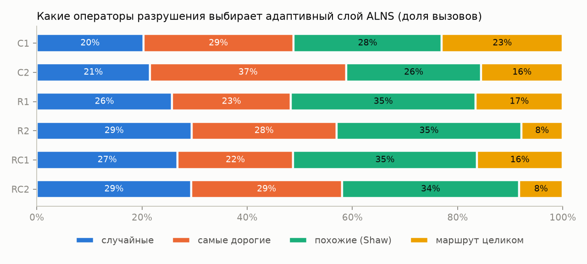
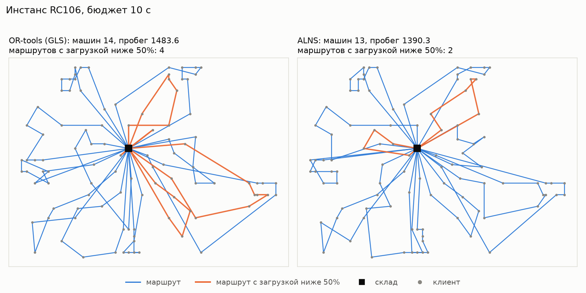

# Результаты

Бюджет 10 с на запуск, стохастические методы — медиана по 3 seed. Цель — 1000 × машины + расстояние. Недопустимых решений: 0.

## Среднее число машин / среднее расстояние по классам

| Класс | Лучшее известное | Жадный | OR-tools (GLS) | ALNS | ALNS, q равномерно | ALNS без адаптации |
|---|---|---|---|---|---|---|
| C1 | 10.00 / 828.4 | 10.44 / 1409.6 | 10.00 / 846.5 | 10.00 / 828.4 | 10.00 / 828.4 | 10.00 / 828.4 |
| C2 | 3.00 / 589.9 | 3.38 / 1085.8 | 3.00 / 593.5 | 3.00 / 601.0 | 3.00 / 599.8 | 3.00 / 601.0 |
| R1 | 11.92 / 1210.3 | 14.67 / 1624.5 | 13.08 / 1231.3 | 12.58 / 1200.3 | 12.58 / 1196.0 | 12.58 / 1203.9 |
| R2 | 2.73 / 951.0 | 3.64 / 1705.2 | 3.09 / 968.7 | 3.09 / 949.7 | 3.09 / 941.5 | 3.09 / 945.7 |
| RC1 | 11.50 / 1384.2 | 14.25 / 1822.3 | 13.50 / 1423.9 | 12.38 / 1371.7 | 12.12 / 1365.8 | 12.38 / 1377.4 |
| RC2 | 3.25 / 1119.2 | 4.00 / 2091.7 | 3.62 / 1168.2 | 3.38 / 1147.4 | 3.38 / 1130.2 | 3.38 / 1143.0 |
| Всего (CNV / CTD) | 405 / 57187 | 483 / 90936 | 442 / 58535 | 425 / 57267 | 423 / 56930 | 425 / 57275 |

## ALNS против OR-tools

Тест Вилкоксона по 56 инстансам: p = 1.13e-07.

| Класс | ALNS лучше | ничья | OR-tools (GLS) лучше | медиана разницы цели |
|---|---|---|---|---|
| C1 | 5 | 4 | 0 | -0.23 % |
| C2 | 1 | 6 | 1 | +0.00 % |
| R1 | 11 | 1 | 0 | -2.97 % |
| R2 | 9 | 0 | 2 | -0.38 % |
| RC1 | 8 | 0 | 0 | -8.47 % |
| RC2 | 7 | 0 | 1 | -1.30 % |
| Всего | 41 | 11 | 4 | -0.40 % |

## Абляция: ALNS против «ALNS, q равномерно»

Тест Вилкоксона: p = 0.000139.

| Класс | ALNS лучше | ничья | ALNS, q равномерно лучше | медиана разницы цели |
|---|---|---|---|---|
| C1 | 0 | 9 | 0 | +0.00 % |
| C2 | 0 | 7 | 1 | +0.00 % |
| R1 | 0 | 10 | 2 | +0.03 % |
| R2 | 1 | 3 | 7 | +0.14 % |
| RC1 | 0 | 5 | 3 | +0.05 % |
| RC2 | 2 | 0 | 6 | +0.42 % |
| Всего | 3 | 34 | 19 | +0.01 % |

## Абляция: ALNS против «ALNS без адаптации»

Тест Вилкоксона: p = 0.615.

| Класс | ALNS лучше | ничья | ALNS без адаптации лучше | медиана разницы цели |
|---|---|---|---|---|
| C1 | 0 | 9 | 0 | +0.00 % |
| C2 | 0 | 8 | 0 | +0.00 % |
| R1 | 1 | 10 | 1 | -0.01 % |
| R2 | 2 | 5 | 4 | +0.02 % |
| RC1 | 3 | 4 | 1 | -0.05 % |
| RC2 | 1 | 0 | 7 | +0.37 % |
| Всего | 7 | 36 | 13 | +0.00 % |

## Операторы разрушения

Средняя награда за вызов (1 — новый рекорд, 0,5 — улучшение, 0,1 — принято хуже, 0 — отклонено):

| Класс | случайные | самые дорогие | похожие (Shaw) | маршрут целиком |
|---|---|---|---|---|
| C1 | 0.021 | 0.044 | 0.017 | 0.015 |
| C2 | 0.021 | 0.051 | 0.016 | 0.014 |
| R1 | 0.050 | 0.053 | 0.042 | 0.029 |
| R2 | 0.063 | 0.066 | 0.054 | 0.025 |
| RC1 | 0.052 | 0.061 | 0.042 | 0.031 |
| RC2 | 0.057 | 0.066 | 0.049 | 0.024 |

## Разбор маршрутов на RC106

| Метод | Маршрутов | Средняя загрузка | Минимальная загрузка | Суммарное ожидание |
|---|---|---|---|---|
| ALNS | 13 | 0.66 | 0.28 | 219.64 |
| OR-tools (GLS) | 14 | 0.62 | 0.08 | 308.05 |
